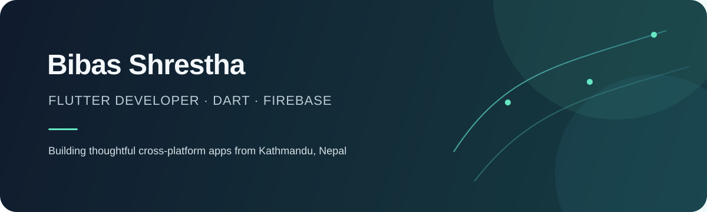

  
   
  
  

## About

I’m a Flutter developer based in Kathmandu, Nepal. I build practical cross-platform apps with a focus on clear user experiences, reliable data, and thoughtful localization.

**Currently building:** [Pocket](https://github.com/bibasshrestha980-npl/expense_tracker), a personal finance app designed for Nepal and beyond.

## Featured work

<table>
  <tr>
    <td width="48%" valign="top">
      
    </td>
    <td valign="top">
      <h3><a href="https://github.com/bibasshrestha980-npl/expense_tracker">Pocket · Personal Finance &amp; Expense Tracker</a></h3>
      
A Flutter and Firebase app for tracking income and expenses, built around the way people manage money in Nepal.

      <ul>
        <li>Transaction logging, dashboard insights, and PDF or CSV reports</li>
        <li>SMS parsing for bank and digital wallet alerts</li>
        <li>Bikram Sambat and Gregorian calendars</li>
        <li>English and Nepali localization</li>
      </ul>
      
<strong>Built with</strong> Flutter · Dart · Firebase Auth · Cloud Firestore · Provider

      <a href="https://github.com/bibasshrestha980-npl/expense_tracker">View source and screenshots →</a>
    </td>
  </tr>
</table>

## Selected projects

| Project | What it is |
|:--|:--|
| [Note App](https://github.com/bibasshrestha980-npl/note_app) | A focused note-taking app |
| [News App](https://github.com/bibasshrestha980-npl/news_app) | A Flutter news reader |
| [Login UI](https://github.com/bibasshrestha980-npl/login_ui_flutter) | A responsive authentication interface |

## Toolkit

  
  
  
  
  
  

## Connect

Kathmandu, Nepal · Open to thoughtful collaborations

[Email](mailto:bibasshrestha980@gmail.com) · [GitHub repositories](https://github.com/bibasshrestha980-npl?tab=repositories)